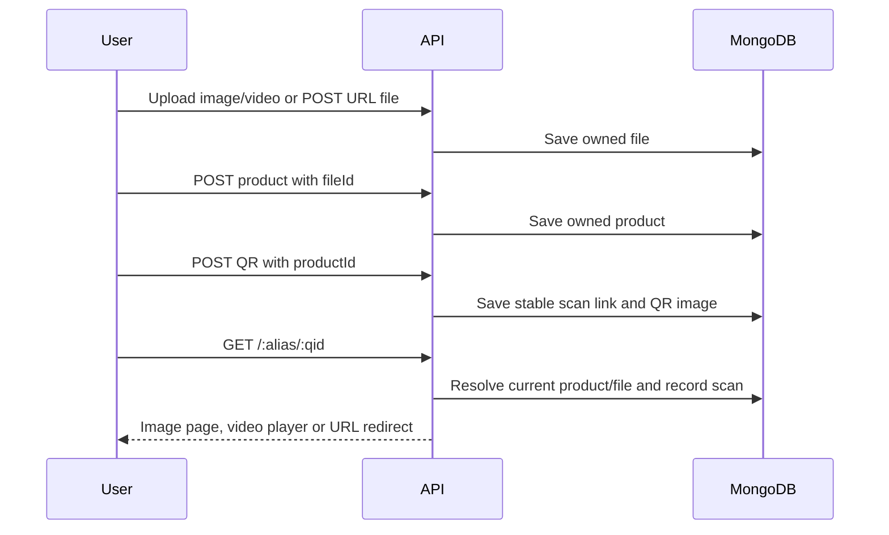

# API and workflows

Default local base URL: `http://127.0.0.1:3000`. Management endpoints require a session cookie. See [authentication](authentication.md) for login examples and [the content workflow](content-workflow.md) for complete file → product → QR examples.

## Public and account routes

| Method | Path | Behavior |
| --- | --- | --- |
| GET | `/health` | Fixed `{"status":"ok"}`; no current dependency probes |
| GET | `/admin/`, extensionless `/admin/*` | React admin/login pages |
| GET | `/crud/` | Legacy JSON CRUD interface |
| GET | `/api-docs/` | Swagger UI |
| POST | `/api/users` | Register and sign in; name, lastName, email and password |
| POST | `/api/users/login` | Email/password login and session rotation |
| POST | `/api/users/logout` | Destroy current session; return 204 |
| GET | `/api/users/me` | Current account without password |
| GET | `/api/users` | Array containing the current account only |
| GET/PUT/DELETE | `/api/users/:id` | Current account only; other users return 404 |

Profile writes support name, lastName, alias and useAlias. Email or password changes also require currentPassword. No administrator user-list endpoint is implemented.

## File, product and QR routes

| Method | Path | Behavior |
| --- | --- | --- |
| GET | `/api/files` | Current account’s files |
| GET | `/api/files/:id` | File metadata |
| GET | `/api/files/:id/content` | Authenticated image/video preview bytes |
| POST | `/api/files` | Create URL file using `{name,type:"web-url",url}` |
| POST | `/api/upload/image/:uid` | Multipart `image` and optional `name`, limit 10 MiB |
| POST | `/api/upload/video/:uid` | Multipart `video` and optional `name`, limit 50 MiB |
| PUT | `/api/files/:id` | Rename any file, and/or change a URL file’s URL |
| DELETE | `/api/files/:id` | Delete unused file; uploaded bytes are also removed |
| GET | `/api/products` | Current account’s products |
| GET | `/api/products/with-options` | Products with attached file, owner and creator populated |
| GET | `/api/products/:id` | Product metadata |
| POST | `/api/products/create/` | Create `{name,description,fileId}` with optional product-page fields; legacy name/description optional |
| PUT | `/api/products/:id` | Edit name, description, owned fileId, legacy alias, displayMode, mediaIds and actionLabel/actionUrl |
| DELETE | `/api/products/:id` | Delete a product not referenced by a QR/category/direct campaign entry |
| GET | `/api/qrcodes` | Current account’s QR codes |
| GET | `/api/qrcodes/with-options` | Codes with product/current file and campaign populated |
| GET | `/api/qrcodes/:id` | QR metadata, saved scan URL and PNG data URL |
| POST | `/api/qrcodes` | Create with exactly one owned target: `{name,productId}` or `{name,campaignId}` |
| POST | `/api/qrcodes/dynamic` | Compatible shortcut `{name,url}`, automatically creating a web file/product |
| PATCH | `/api/qrcodes/:id` | Edit name/status, assign owned productId/campaignId, or legacy website destinationUrl for product targets |
| PUT | `/api/qrcodes/:id` | Legacy alias update |
| DELETE | `/api/qrcodes/:id` | Delete code without deleting product/file |
| GET | `/api/qrcodes/qr-code/:id` | Owned QR image HTML |
| GET | `/api/qrcodes/videos/:type/:qid` | Owned content-delivery helper (including images) |
| GET | `/api/qrcodes/play-video/:qid` | Owned scan-page helper; records a statistic |

Ownership is set from the session. Optional legacy userId/createdBy values must match it. References must belong to that account. Unknown fields and MongoDB update operators are rejected. Uploaded paths/types/MIME metadata cannot be set through generic JSON CRUD. Image formats are JPEG/PNG/WebP/GIF, and video formats are MP4/MOV/AVI/MKV variants; see [upload details](content-workflow.md#files).

File URL changes update associated product URL copies and clear QR overrides. Replacing a product file updates its assigned codes’ file snapshots and clears their overrides. Public resolution reads the current file, while explicit legacy per-QR website overrides remain supported until reset by these operations or reassignment.

## Public scan flow

`GET /l/:alias/:type/:qid` serves media or redirects without adding another scan. Type aliases are image `i`, video `v`, and web URL `u`. Paused codes return 410 on both public paths. Reassignment or content replacement preserves the saved QR image and scan link.

`api`, `api-docs`, `l`, `admin` and `crud` are reserved public aliases. The owner alias segment itself is not currently validated by playback lookup; non-ID legacy QR aliases are not unique.

The scan URL uses the account alias if enabled, otherwise `q`, and the configured `PUBLIC_URL` or request origin. Use a reachable public hostname before printing. The active renderer uses the existing branded 2024-pixel QR service; `QrCodeServiceNew` remains unused.

## Statistics

| Method | Path | Behavior |
| --- | --- | --- |
| GET | `/api/statistics` | Statistics for the account’s existing QR codes |
| GET | `/api/statistics/:id` | Owned code statistic |
| GET | `/api/statistics/by-codes/:qid` | `{count,statistics}` |
| GET | `/api/statistics/total-by-codes/:qid` | `{count}` |

Writes are asynchronous; a new count may not appear immediately. Counts represent requests, including repeat/test scans, without visitor deduplication.

## Responses

Generic file creation, QR creation and registration return 201. Product creation and uploads return 200 with `{message,product}` or `{message,file}`. Logout returns 204. Foreign/missing management records return 404, malformed input 400, conflicting ownership claims 403, unsupported upload MIME types 415 and referenced resource deletion 409. Some legacy public lookup/type failures return 406. Database-related workflow writes are not an atomic transaction.

## Categories and campaigns

`GET/POST /api/categories` and `GET/PUT/DELETE /api/categories/:id` manage ordered owned product lists. Equivalent `/api/campaigns` routes manage mixed product/category entries. `GET /api/campaigns/:id/products` returns `{count,products,distribution}` for the live deduplicated pool and current weight/probability preview, including attached files. POST returns 201; PUT replaces editable fields. See [request bodies and validation](campaigns.md#data-and-api).

Campaign QR scans select one distinct eligible product according to its campaign weight (default 1 for equal chances). Paused campaigns return 410; empty eligible pools return 409. Image/video pages pass a 30-minute selection token to the public media route, which serves that selected product without redrawing. Campaign media requests require the token; direct product requests retain their previous URLs. Scan/media responses use no-store caching. Statistics include selected `product` and optional `campaign` IDs. See [selection behavior](campaigns.md#one-selection-per-scan).

New scan records include bounded request method/path, duplicate-preserving query parameter pairs and optional referrer in `data.request`. The Analytics table lists all returned scans with filters, pages and a complete field/value details view. Existing records have no reconstructed request context. See [analytics metadata](analytics.md) and [campaign weight API](campaign-weights.md).

Analytics UI deep links use `/admin/analytics` for Overview and `/admin/analytics?tab=scans&qrCode=QR_ID` for a QR-specific Scan details list. These client query parameters filter the existing authenticated scan collection and do not change the statistics API or public scan recording.

Product-page payloads and public attachment query parameters are documented in [product pages](product-pages.md).

## Public browser collection

HTML QR navigations collect allowlisted browser metrics before continuing to content. `POST /scan/:token/metrics` accepts a single bounded browser snapshot, and `GET /scan/:token/continue` delivers the already selected content without another scan event. These short-lived, scan-specific capabilities need no account login; arbitrary statistic IDs cannot be submitted. Non-HTML clients retain direct delivery. See [browser metrics](browser-metrics.md) for payload fields, validation, location permission and fallbacks.

HTML scans also establish a signed first-party visitor cookie. Statistics may include `data.visitor` and `data.browserFingerprint`; metrics submissions use same-origin credentials to confirm recognition. These IDs are owner-scoped and do not authenticate a visitor. See [visitor recognition](visitor-recognition.md).

Combined evidence and activity counters are available in the [visitor profile views and API](visitor-profiles.md), including expanded browser capability/network hints. These are observed signals for future game/targeting rules, not verified personal interests or an implemented restriction engine.
