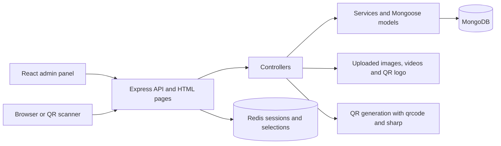

# Architecture

QR2Share is an Express 4 application written in TypeScript. It stores records in MongoDB through Mongoose, sessions and temporary campaign selections in Redis, and uploaded images/videos on disk. It serves a React admin panel, a legacy CRUD interface, and HTML for QR images, shared images and video playback. The React panel uses typed feature modules, React Router and TanStack Query; see [admin architecture](admin-panel.md).

## Source layout

| Location | Responsibility |
| --- | --- |
| `src/index.ts` | Load environment, initialize app, bind HTTP listener |
| `src/app.ts` | Connect database, install middleware, mount routes |
| `src/routes/` | HTTP method and URL mapping |
| `src/controllers/` | Request handling, response bodies and workflow orchestration |
| `src/services/` | Shared CRUD operations, uploads, QR rendering and statistics queries |
| `src/models/` | Mongoose schemas and references |
| `src/middlewares/` | Visitor identification and error handling |
| `src/utils/device.fingerprint.utils.ts` | User agent parsing, IP/geolocation and fingerprint hashing |
| `client/src/` | React app shell, feature modules, typed API client and design styles |
| `public/admin/` | Generated Vite output served by Express, ignored by Git |
| `src/services/dynamic-qrcode.service.ts` | QR creation from existing products, compatible URL shortcut, compensating cleanup and scoped assignment edits |
| `public/crud/index.html` | Browser interface for users, files, products and QR codes |
| `uploads/videos/` | Uploaded video bytes |
| `uploads/media-images/` | Uploaded user images, separate from branding |
| `uploads/images/` | Branding assets used in generated QR images |
| `dist/` | Compiled JavaScript used by `npm start` |

## Startup and request order

`src/index.ts` loads dotenv and calls `initApp()`. Initialization waits for MongoDB before creating the HTTP listener. Database connection failure exits the process. Redis is constructed during module loading; startup does not explicitly await a Redis readiness check.

The listener uses `HOSTNAME` (default `127.0.0.1`) and `PORT` (default `3000`). Middleware runs in this order:

1. Trust proxy is enabled for all proxies.
2. Redis-backed Express session middleware.
3. JSON parsing, then visitor identification stored in `res.locals`.
4. Swagger UI at `/api-docs` and static files from `public/`.
5. CORS configuration.
6. Public health/root routes, React deep-link fallback, and API write-origin protection.
7. Public account registration/login/logout; authenticated account and resource management routes.
8. Public QR playback and media routes.
9. Upload and general error handlers.

JSON is parsed before identification so body-provided dimensions and timezone are available. CORS is installed after Swagger and static serving, so those earlier handlers do not receive its headers. API writes enforce a permitted Origin (or reject a cross-site Fetch Metadata signal), independently of CORS.

Authentication middleware loads the account from the session and checks its `authVersion`. Management middleware establishes a query scope, validates references and allowlists writable fields. Shared CRUD queries carry that scope into reads, updates and deletes. Public playback deliberately bypasses management authentication.

## Data model

| Collection | Main fields and relationships |
| --- | --- |
| `users` | Required name, lastName, unique email and password hash; alias, useAlias, active and authVersion fields |
| `files` | Optional label, type (image/video/web-url), URL and creator; upload metadata required for image/video |
| `products` | Optional name/description, one current file reference, compatibility URL/path copy, owner and creator; default alias `c` |
| `categories` | Named ordered product references, description and creator |
| `campaigns` | Named mixed product/category entries, random rule, optional per-product integer weight overrides (default 1), active/paused status and creator |
| `qrcodes` | Exactly one product or campaign target, owner and creator references; optional product file snapshot stored as a string; generated image data URL and scan URL, optional name/destination override and active/paused status; default alias `c` |
| `statistics` | QR code, selected product and optional campaign references, plus mixed visitor data including fingerprint information and bounded request context |

References are stored by ID; selected read paths populate them. Files can be shared across products, and products across QR codes, categories and campaigns. File deletion is blocked while referenced by products; product deletion is blocked while assigned to QR codes, categories or direct campaign entries. Referenced categories/campaigns also have deletion guards. Unused uploaded file deletion removes its bytes. QR deletion preserves its product/file. Save hooks set timestamps. Generic updates use scoped `findOneAndUpdate` with `$set`, `runValidators: true` and an explicit updated timestamp. Account updates use `save()` so password hashing runs.

## Sessions and analytics

Sessions use `connect-redis` and `express-session`, with `saveUninitialized: false` and a one-day cookie lifetime. Login/registration regenerate and explicitly save the session. Changing a password increments an account version, invalidating its other sessions. Production startup requires `SESSION_SECRET`. Cookies are HTTP-only. Production cookies use `secure: true` and `sameSite: none`; development uses `secure: false` and `sameSite: lax`.

Passwords use salted scrypt hashes, are excluded by default from queries and are removed during JSON serialization. Existing bcrypt hashes are accepted at login; plaintext passwords are not. See [authentication](authentication.md).

The fingerprint hashes browser name, OS name, language, screen dimensions and timezone. It does not uniquely establish a person's identity. Analytics also retain the IP, an IP hash, parsed user agent and a local GeoIP lookup result.

Paused QR routes return 410 without logging a scan. Public scans resolve the assigned product, or randomly select one distinct eligible campaign product, then resolve its current attached file: image page, video player or URL redirect. Active website codes use a legacy per-QR destination override when present. Product file changes or QR reassignment clear that override. The image and scan URL remain stable across destination edits.

Each resolved public scan through `/:alias/:qid` attempts to create a statistic asynchronously. Failed statistic writes are logged without blocking playback. Requests to the media-serving route do not add statistics. Counts represent recorded scan requests, without deduplication by visitor.

Redis state/cache helpers exist, but cache middleware is not mounted in the current routes. Sessions, auth rate limits and 30-minute campaign selection tickets are the active Redis integrations.

## Storage and deployment

Local execution uses paths relative to the repository working directory. QR rendering requires `uploads/images/qr2share-logo-circle.png`.

The Dockerfile builds with Node 22, installs the backend and client lockfiles, compiles TypeScript, bundles React into `public/admin/` and runs the compiled app as the `node` user. Compose starts the app, MongoDB 7 and Redis 7. Named volumes preserve database data, Redis data, uploaded videos and uploaded images. `image_uploads_data` mounts at `/app/uploads/media-images`, preserving the existing video volume. Only the app is published by this Compose configuration, on the host loopback interface; MongoDB and Redis are accessed by service name inside Docker.

Sources: [app](../src/app.ts), [entry point](../src/index.ts), [models](../src/models/), [session configuration](../src/config/sesion.config.ts), [Compose](../docker-compose.yml).

The main product model and update semantics are documented in [Files → Products → QR codes](content-workflow.md). File URLs and product references are synchronized with multiple writes; these operations do not provide a transaction across MongoDB documents or the filesystem.

## Campaign services

`src/routes/collection.routes.ts` mounts account-scoped category/campaign CRUD. `src/services/campaign.service.ts` validates owned references and expands/deduplicates live campaign pools. `src/services/qr-playback.service.ts` resolves targets and pins a campaign media selection in Redis, revalidating it without another draw on media requests. See [campaign behavior and lifecycle](campaigns.md).

Analytics reads existing account-scoped statistics through the workspace query. The client scan table filters/pages these records and renders every stored field in a details dialog. New successful scan events include a bounded request snapshot without cookies or authorization headers. See [scan details](analytics.md) and [weighted campaign selection](campaign-weights.md).

## Product-page rendering

Products retain their primary file for compatibility and may add `displayMode`, ordered `mediaIds`, and an action label/URL pair. `product-page.service.ts` renders escaped public HTML. The playback controller loads only owned gallery files and reuses campaign selection tickets for attachment delivery. See [product pages](product-pages.md) for validation and access behavior.

## Browser scan enrichment

HTML QR navigation records one server scan, then uses a 10-minute Redis capability and a same-origin browser collector before content delivery. `browser-scan.service.ts` validates/enriches that scan; continuation revalidates the original product/file and campaign selection. Browser values stay under `data.browser`, separate from request-derived fingerprints. See [browser metrics](browser-metrics.md).

## Visitor recognition

`visitor.service.ts` signs first-party visitor cookies and derives owner-scoped HMAC IDs and estimated browser fingerprints. Scan documents store recognition separately from the original request fingerprint. A compound QR/visitor/confirmation index supports returning-browser lookups. The browser metrics and continuation endpoints confirm cookies without requiring an account. See [visitor recognition](visitor-recognition.md).

Combined evidence and activity counters are available in the [visitor profile views and API](visitor-profiles.md), including expanded browser capability/network hints. These are observed signals for future game/targeting rules, not verified personal interests or an implemented restriction engine.

HTML scans of direct URL products now attempt [automatic iframe delivery](embedded-content.md) after browser collection, with automatic redirect fallback. Explicit product-page mode retains its existing gallery and link/action behavior.
