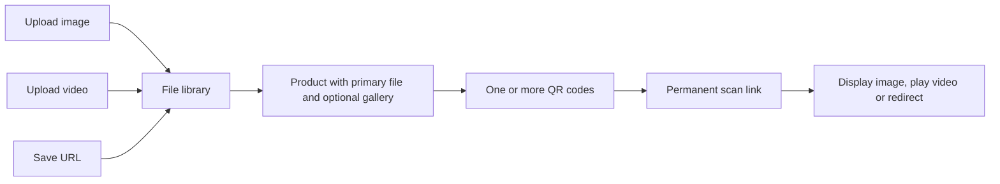

# Files → Products → QR codes

This is QR2Share’s main content model. The React panel exposes the same separate entities as the development APIs, with image upload and delivery added.



A file can be reused by several products. A product has one primary attached file, optional additional media, and can be assigned to several QR codes. Its scan experience is either direct file delivery or a [product page](product-pages.md) with a gallery and action button. Users own each of these records; there is no organization-wide administrator role.

## Use the admin panel

1. Open **Files** at `/admin/files`, click **Add file**, and choose Image, Video or URL. Give the file a name, then upload or enter its URL. You can preview uploaded media and open saved URLs.
2. Open **Products** at `/admin/products`, click **Create product**, add a name/optional description and choose an attached file. Alternatively use a file row’s **Create product** action, which preselects that file.
3. Open **My QR codes**, click **Create QR code**, name the code and select a product. Alternatively use **Create QR code** on a product card, which preselects it.
4. Download the saved QR PNG. A scan displays the attached image, renders the attached video, or redirects to the attached URL.

To change shared content, edit a product and select another uploaded/saved file. All QR codes assigned to it follow the new file. To change just one code’s assignment, use its **Edit QR target** action. The saved QR image and scan URL stay unchanged in both cases.

Editing a URL file updates products that use it. Renaming an uploaded file changes its label; replacing the actual media means uploading a new file and attaching it to the product.

## Files

| Type | Creation | Storage and behavior |
| --- | --- | --- |
| `image` | `POST /api/upload/image/:uid`, multipart `image`, optional `name` | JPEG, PNG, WebP or GIF, up to 10 MiB; stored under `uploads/media-images/`; image metadata must match declared MIME type |
| `video` | `POST /api/upload/video/:uid`, multipart `video`, optional `name` | MP4, MOV/QuickTime, AVI or MKV, up to 50 MiB; stored under `uploads/videos/`; browser playback depends on format/codec support |
| `web-url` | `POST /api/files` with `{name,type:"web-url",url}` | An http/https URL without embedded credentials; no uploaded bytes |

`GET /api/files/:id/content` serves an owned image/video for management previews. It requires login and ownership. Public media access happens through the assigned QR route, so a paused QR cannot be bypassed by opening this private preview without authorization.

Uploads use UUID filenames with an extension selected from the allowed MIME type. Original names are metadata, not filesystem paths. Image uploads are checked with Sharp metadata; SVG is not accepted. Videos are MIME-filtered and are not transcoded or fully decoded during upload. Failed image validation or database saves remove the newly written upload. This is not a malware-scanning service.

`PUT /api/files/:id` accepts `name` for any file, and `url` for web files. File type, ownership and filesystem metadata cannot be edited. Labels are limited to 120 characters.

## Products

Create with:

```json
{
  "name": "Product demonstration",
  "description": "A short introduction to our product.",
  "fileId": "OWNED_FILE_ID"
}
```

POST to `/api/products/create/`. The description is optional and limited to 1000 characters; product names are limited to 120. Name is optional for legacy API callers, with a fallback from the attached file. Ownership is filled from the session. The old optional `userId` must match that session if supplied.

`GET /api/products/with-options` populates the attached file for cards and selection. `PUT /api/products/:id` accepts name, description and an owned `fileId` (also the legacy alias field), plus `displayMode`, `mediaIds`, `actionLabel` and `actionUrl` described in [product pages](product-pages.md). Attaching a new file updates the product’s compatibility URL/path and the QR records’ file snapshots, and removes direct URL overrides on those QR codes so they follow the selected file.

## QR assignment

Create with `POST /api/qrcodes`:

```json
{
  "name": "Product packaging",
  "productId": "OWNED_PRODUCT_ID"
}
```

The service checks the product and file ownership, renders the QR before inserting its document, and uses `PUBLIC_URL` as the scan-link base when configured, otherwise the request origin. The file and product already exist; creation does not silently create replacements for them.

Use `PATCH /api/qrcodes/:id` with `{productId:"ANOTHER_OWNED_PRODUCT_ID"}` to reassign it. Name and active/paused status can be included. Product reassignment removes a previous direct URL override on that QR. An override and product reassignment cannot be submitted together.

The earlier URL shortcut `POST /api/qrcodes/dynamic` remains compatible for API clients. It automatically creates a URL file and product; it is not the main React creation form. Existing direct destination overrides remain supported by the API until the file/product is changed or the QR is reassigned. Ordinary file/product workflows resolve the product’s current attached file at scan time.

Public routes:

- `GET /:alias/:qid`: record a scan and show an image/video page or redirect to a URL.
- `GET /l/:alias/:type/:qid`: serve media/redirect without another scan event. Type aliases are `i`, `v`, and `u` for image, video and URL.
- Paused codes return 410 on both public routes.

Image HTML escapes labels, video sources use the stored MIME type, and media paths are restricted to the user upload directories. The existing `getVideo`/`playVideo` controller method names remain for compatibility but now handle images as well.

## Deletion and persistence

Deleting a referenced file returns 409: remove its primary and additional-media references from products first. Deleting a product referenced by a QR, category or direct campaign entry returns 409: remove or reassign those references first. The UI disables those deletes while a reference is visible; the API also enforces the check.

Deleting a QR preserves its product and file. Deleting an unreferenced product preserves its file. Deleting an unreferenced uploaded file removes both its MongoDB document and physical media (filesystem cleanup errors are logged). Historical statistics are not automatically purged by QR deletion.

Docker preserves video uploads in `uploads_data` and image uploads in the separate `image_uploads_data` volume. Existing video data/volume paths are unchanged. Branding images remain under `uploads/images/`, outside the user image directory.

Product/file changes synchronize related documents with multiple writes. Standalone MongoDB does not provide an atomic transaction for this workflow; database failures or concurrent reference creation can require reconciliation. The deletion checks are not a database-level foreign-key constraint.

## Verification

An isolated backend integration scenario covers image/video/URL files, image validation, authenticated previews, ownership rejection, file reuse, product file replacement, QR reassignment, stable QR images/URLs, correct media responses, pause/resume, reference deletion guards and physical deletion of unused uploads.

Browser scenarios exercise URL file → product → QR creation, QR reassignment, a decoded PNG download, image upload/display, MP4 upload/playback, product file replacement and deletion guard states. The MP4 is a generated 0.5-second, 64×48 test fixture, without external footage. Test databases, session keys and uploaded fixtures are cleaned up after testing.

## Optional categories and campaigns

The direct product flow remains available. You can also arrange products into reusable ordered categories, combine categories and individual products in a campaign, then assign that campaign to a QR using `{campaignId}`. Each scan chooses one distinct eligible product at random; category order organizes the list and does not prescribe playback order. Editing category membership updates its campaigns live. Media requests keep the product selected by that scan through a short-lived ticket. See [complete campaign workflow](campaigns.md).

Campaign product weights default to equal chances (1 each); increasing a product weight changes its relative frequency without changing the file or QR. See [weights](campaign-weights.md). Individual recorded selections and request parameters can be inspected in the [scan analytics table](analytics.md).

HTML browser scans now pass through a brief [browser metrics collection step](browser-metrics.md) before direct playback, URL redirect or product-page delivery. It retains the original scan and campaign selection; media and continuation requests add no scan events.
